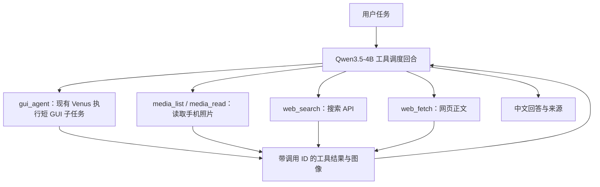

# Qwen3.5-4B + Venus：GUI、联网搜索和手机系统工具接入方案

调研日期：2026-11-01（Asia/Shanghai）。本次产物是源码调研与实施设计；尚未接入工具、调用付费搜索接口或完成真机端到端测试。

## 1. 当前系统与必须补的能力

当前 GUI benchmark 配置使用 `Qwen3.5-4B`，策略为 Venus `ui_venus_2`。实际执行框架是 `/home/kojoker/projects/UI-Venus/Venus_framework/Venus_framework_mobile`，不是本工作目录中用于既往研究的 reference 副本。

模型负责看图、理解任务、生成动作；Venus/harness 负责截图、构造上下文、请求模型、解析动作、操作手机和记录轨迹。给 Qwen 增加工具不需要先更换或训练模型，但需要验证 4B 的调用可靠性。

本地查到的关键缺口：

| 位置 | 现有行为 | 接入时需要处理的事 |
|---|---|---|
| `policy/ui_venus_2_policy.py:195` | `_call_model()` 不传 `tools`；返回字符串，只取 `message.content` 与 reasoning | 新工具回合必须保留 `message.tool_calls` 和调用 ID |
| `policy/ui_venus_2_policy.py:30` | `ACTION_NAME_MAP` 只认识 GUI/结束类动作 | 不能直接把 `web_search(...)` 丢进旧动作解析器 |
| `processor/ui_venus_2_processor.py:82` | 每步重建 system、截图与动作描述历史 | 搜索结果必须进入持久工具历史，否则下一步会丢失 |
| `app/run_handler.py:106` | 每步先截图，最后可由 SUCCESS 声明任务完成 | API-only 路线应避免无用截图；识别和历史介绍要独立验收 |
| `benchmarks/gui_v1/worker.py` | 请求参数与原始配置严格比对 | 新实验单独建立配置和记录格式，不能直接套用旧 worker |

当前 `benchmarks/gui_v1/config.yaml` 的温度为 0；单独的 `benchmark_qwen35_4b.yaml` 写的是 1。讨论既往温度 0 批次，应以该批冻结配置和真实请求为准。

现有证据 `/home/kojoker/Documents/ChatGPT/h20/deliverables/qwen-codex-harness-tool-report-20261020.md` 中，原生 `tool_calls → 工具执行 → role=tool → 最终回答` 跑通的是 **Qwen3.8-27B**，不能当作 Qwen3.5-4B 已验证的证据。

现场检查：`adb devices -l` 未列出手机。对历史模型地址 `172.23.148.117:18082` 的匿名只读探测得到健康检查超时及 models/version HTTP 502；本轮不能确认该地址此刻加载的模型或推理引擎状态。未切换、重启模型服务。

## 2. Codex 如何实现 web search

Codex 公开仓库可查，第一项无需因“源码不可看”而放弃。但公开客户端源码和搜索服务后端是不同的证据范围。

本次固定源码提交：`openai/codex@67f0994b532b8740f14b5b738af7b7b2a915b1d6`。

| 源码 | 已确认内容 |
|---|---|
| `codex-rs/core/src/tools/hosted_spec.rs:14` | `create_web_search_tool()` 构造 `ToolSpec::WebSearch`，配置缓存、索引门控、实时访问等选项 |
| `codex-rs/core/tests/suite/web_search.rs:33` | 测试验证 cached 请求包含 `external_web_access=false` |
| `codex-rs/core/src/web_search.rs:18` | 展示 Search、OpenPage、FindInPage 等搜索动作的详情 |
| `codex-rs/core/src/stream_events_utils.rs:458` | 对服务返回的 `ResponseItem::WebSearchCall` 进行事件/历史处理 |

官方文档说明 Codex 本地对话的搜索缓存来自 OpenAI 维护的结果索引；实时模式访问网页。Responses 文档给出 `web_search_call`、search/open_page/find_in_page 和 URL 引用注解。

因此可以学习：工具声明、搜索/打开/查找动作、结果及引用记录、缓存/实时选择。**这些文件没有提供可直接独立部署的 OpenAI 搜索索引、抓取和排序后端。** 给本地 Qwen 的 Chat Completions 请求只加 `{"type":"web_search"}`，不会获得 OpenAI 的搜索服务。Qwen 侧应定义普通 function 工具，宿主执行真实搜索。

来源：[Codex 配置](https://developers.openai.com/codex/config-basic/)、[OpenAI web search](https://developers.openai.com/api/docs/guides/tools-web-search)、[hosted_spec 源码](https://github.com/openai/codex/blob/67f0994b532b8740f14b5b738af7b7b2a915b1d6/codex-rs/core/src/tools/hosted_spec.rs)。

## 3. DeepSeek Harness 的实现更适合作为接入参考

虽然条件性备选无需启动，本次也检查了官方 `deepseek-ai/deepseek-harness`，固定提交 `ce7073d51254c26cd63b22a60835b8f948deb447`。默认分支是 master。

它将面向模型的工具、共享 web 服务和检索提供方分开：

```text
模型调用 web_search / web_fetch
  → tool-web：参数校验、结果格式、上下文限制
  → ctx.web：选择提供方
  → Search / Fetch API 或其他已配置后端
  → 来源、摘要、网页正文及错误
  → 工具结果回到模型上下文
```

精确源码地图：

| 源码路径 | 内容 |
|---|---|
| `packages/web/tool-web/src/search.ts` | 模型工具使用 `queries: string[]`，校验非空和数量；默认最多 4 个查询、8 个来源、每来源摘要最多 800 字符 |
| `packages/web/tool-web/src/fetch.ts` | `web_fetch` 取网页并转成受长度限制的模型可读内容 |
| `packages/web/web-deepseek-api/src/search.ts` | 专用 Search API，默认 `https://api.deepseek.com/v1/tools/search`；传 `query/count/need_content:false`，解析 `results[].url/title/snippet/summary/date` |
| `packages/web/web-deepseek-api/src/fetch.ts` | 专用 Fetch API；取网页 Markdown |
| `packages/web/web-search-deepseek/src/provider.ts` | 另一条实现：Anthropic 兼容 Messages 请求携带 `web_search_20250305`；消耗辅助模型回合，解析结构化结果块 |
| `packages/web/web-fetch-http/src/provider.ts` | 匿名 HTTP 抓取、响应大小限制、重定向控制、内容类型检查 |

重要区别：专用 Search/Fetch API 不额外要求一个模型生成回合；Messages 搜索需要一个辅助模型回合。因此以低延迟为目标时，优先验证专用检索 API。源码显示接口接入方式，不代表我们现有账号已经获得权限、额度或访问能力。

建议选择：先验证 DeepSeek 专用 Search/Fetch 的账号可用性；如不适用，使用已授权的 Tavily 或 Brave Search API。Tavily 支持返回原始内容；Brave 提供搜索结果，需要另接网页正文抓取。后端通过统一接口替换，不写死进提示词。搜索 API 通常需要凭据与额度，本次未检查密钥值或发起计费调用。

来源：[DSH 模型工具](https://github.com/deepseek-ai/deepseek-harness/blob/ce7073d51254c26cd63b22a60835b8f948deb447/packages/web/tool-web/src/search.ts)、[DSH 专用 API](https://github.com/deepseek-ai/deepseek-harness/blob/ce7073d51254c26cd63b22a60835b8f948deb447/packages/web/web-deepseek-api/src/search.ts)、[DSH 中文说明](https://github.com/deepseek-ai/deepseek-harness/blob/ce7073d51254c26cd63b22a60835b8f948deb447/packages/web/web-deepseek-api/README.zh.md)、[Tavily](https://docs.tavily.com/documentation/api-reference/endpoint/search)、[Brave](https://api-dashboard.search.brave.com/app/documentation/web-search/get-started)。

## 4. 推荐接入方式：先在 Venus 上面补一个工具调度层

第一版推荐由同一个 Qwen3.5-4B 服务承担调度与 GUI 视觉推理，但两种上下文分开：调度器使用原生 function calling；`gui_agent` 工具执行时调用现有 Venus 的受限子任务。这里是程序模块调用，不要求增加第二种模型或新建聊天。

这样能先复用原 GUI 实现，并验证“模型自主选择 GUI、文件读取、搜索、正文抓取”的完整链路。其代价是 GUI 子任务会多一个调度回合。跑通后，如该开销明显，再增加 `ui_venus_2_hybrid` 策略，把 GUI 动作也统一成原生函数调用。



| 工具 | 第一版职责 |
|---|---|
| `web_search(query, max_results)` | 返回来源 ID、标题、URL、摘要、检索时间；失败返回结构化错误 |
| `web_fetch(url)` | 返回正文、引用 URL、截断标记和抓取状态；搜索摘要不等于已读正文 |
| `media_list(collection, order, limit)` | 查询媒体列表，按固定规则得到首图及排序证据 |
| `media_read(media_id)` | 读取指定图片，返回宿主资产 ID、哈希、尺寸及可用 EXIF，并给模型附加图片 |
| `gui_agent(task, max_steps)` | 调用现有 Venus，完成明确的短 GUI 子任务，返回轨迹和可观察结果 |

建议新增 `/home/kojoker/projects/UI-Venus/benchmarks/hybrid_v1/`，包含 `runner.py`、`tool_registry.py`、`providers/`、`media.py`、`gui_adapter.py`、`cases.yaml`。这是计划中的路径，本次没有创建这些实现文件。原 `gui_v1` 保留作比较基线。

模型侧 schema 示例（设计示例，不是实际请求日志）：

```json
{
  "type": "function",
  "function": {
    "name": "web_search",
    "description": "Search the web and return source URLs and snippets. Use web_fetch to read a page.",
    "parameters": {
      "type": "object",
      "properties": {
        "query": {"type": "string", "minLength": 1},
        "max_results": {"type": "integer", "minimum": 1, "maximum": 5}
      },
      "required": ["query"],
      "additionalProperties": false
    }
  }
}
```

最重要的执行闭环（伪代码，省略初始化和日志实现）：

```python
for round_index in range(max_rounds):
    msg = client.chat.completions.create(
        model="Qwen3.5-4B", messages=messages,
        tools=registry.chat_schemas(), tool_choice="auto",
    ).choices[0].message
    messages.append(msg.model_dump(exclude_none=True))
    if not msg.tool_calls:
        return msg.content
    image_observations = []
    for call in msg.tool_calls:
        result = registry.validate_and_execute(call)
        messages.append({
            "role": "tool", "tool_call_id": call.id,
            "content": result.text_json,
        })
        image_observations.extend(result.images)
    # 工具文本结果全部补齐后，再附加模型支持的 image_url 用户观察消息。
    # 宿主本地路径不能直接当成远程模型可访问的图片 URL。
    messages.extend(as_user_image_messages(image_observations))
raise ToolBudgetExceeded()
```

必须保存 assistant 原始 `tool_calls` 和每个匹配的 `tool_call_id`；不能只保存一段“已经搜索”文字。媒体结果中的本地路径不代表远程模型已经看过图片，须通过服务支持的多模态消息上传图像。网页内容只作为资料输入，不作为新的操作指令。

第一道验收：Qwen3.5-4B 在当前推理服务上能否输出原生工具调用。核对该服务的 auto tool choice、匹配 Qwen3.5 模板的 parser、reasoning 处理和多模态支持。不要未经验证直接沿用 27B 的 parser 参数。若当前服务只能返回文本工具格式，应增加显式适配器并测对照；不要静默用正则冒充原生 `tool_calls`。

工程上在宿主限制工具名和参数、URL 出站范围、超时/重试/结果长度；抓取端阻止从公网 URL 跳进本地模型服务等私网地址。无凭据/超时/空结果/不支持的页面要成为可观察错误，而不是生成一段貌似搜索过的回答。

## 5. 手机 GUI 中哪些能抽象成 API

手机操作是否可绕过 GUI，取决于系统公开能力、文件权限和应用公开接口；“后台有网络请求”不等于第三方可调用。

| 原 GUI 行为 | 可用抽象 | 限制/建议 |
|---|---|---|
| 打开图库、滚动找照片 | Android MediaStore 查询 | 先固定集合、日期排序、截图过滤和云图处理规则 |
| 点图看原图 | ContentResolver 读取 URI；已授权 ADB 环境中尝试读取共享存储 | 不默认能访问 App 私有目录或只有云端的文件 |
| 查看图片详情/地点 | ExifInterface 读时间、方向、GPS；地图反向地理编码 API | GPS 可能不存在或被权限机制脱敏 |
| 打开浏览器、输入搜索词 | Search API | 不再依赖搜索页布局 |
| 打开网页、滚动读正文 | HTTP Fetch/正文抽取；必要时受控浏览器 | JS 页面、登录页、付费内容可能无法直接读取 |
| 打开应用、地图导航、拨号面板 | Android Intent / App Link | 仅在系统或应用公开支持范围内使用 |
| 截图、读取设备状态 | ADB 或授权设备端组件 | 截图 API 与点击坐标本身仍是设备控制，不是 App 业务 API |
| 日历、联系人等系统数据 | 对应 ContentProvider/API | 需适用权限；写入与读取分别设计 |
| 给普通微信好友发送消息 | 未发现通用的官方个人号任意私聊发送 API | 仍需微信 GUI、用户参与的官方分享，或改成受支持的业务账号场景 |

实验原型：沿用已授权的 ADB 查询/读取共享存储，实际核验该手机的 shell 权限。正式设备组件：MediaStore + ContentResolver；目标 Android 版本不同，可能涉及 READ_MEDIA_IMAGES、限定照片访问、旧版存储权限。Android 10+ 读取未脱敏 EXIF 地理位置还涉及 ACCESS_MEDIA_LOCATION，不能假设有图库读取权限就一定有 GPS。

“第一张照片”建议默认定义为：所有本地可读图片，`DATE_TAKEN DESC`，缺失回退 `DATE_ADDED`，稳定 tie-break `_ID DESC`。但这不保证等于某个厂商图库的视觉首图或微信媒体选择器首图。正式对比前，以图库实际集合/过滤/排序校准，保存媒体 URI、文件哈希和排序证据。模型生成的截图也可能排到首位，需要明确是否纳入。

来源：[Android 共享媒体](https://developer.android.com/training/data-storage/shared/media)、[ExifInterface](https://developer.android.com/reference/androidx/exifinterface/media/ExifInterface)、[常见 Intent](https://developer.android.com/guide/components/intents-common)。

## 6. 微信官方能力：按账号和使用场景区分

| 路线 | 可实现什么 | 不能据此推导什么 |
|---|---|---|
| 微信 OpenSDK 分享 | 应用构造文字、图片、网页消息，`api.sendReq(req)` 拉起微信分享流程 | 不等于可后台指定任意个人好友静默发送；需应用接入和微信交互 |
| 企业微信自建应用 `message/send` | 向应用可见范围内企业成员发送应用消息 | 不能把 `touser` 填普通微信好友昵称 |
| 微信客服 `kf/send_msg` | 在已配置客服账号及有效会话中回复用户 | 本次查到文档为用户发消息后 48 小时内最多 5 条；不适用于个人好友通道 |
| 企业微信客户联系群发 | 创建向客户/客户群发送的群发任务 | 官方明确要求成员确认后执行，建任务不等于已发出 |
| 现有授权设备 GUI 自动化 | 在测试手机上操作个人微信前台 | 用户授权设备操作不意味着第三方自动化受到微信官方 SDK 承诺支持 |

对于当前 `Y_Yao` 个人私聊测试，如果目标必须保持同一个人号及聊天通道，仍先使用现有 GUI。可以将文件读取、搜索和内容准备改成 API，只保留微信选人和发送等必要步骤。如果目标只是让用户收到介绍，第一版直接在 harness 对话中输出中文和来源即可；没有必要先解决微信后台发送。

验收区分：API 接受请求、客户端发出、对方收到、图片可打开/视频可播放是不同状态。微信客服官方文档也明确 API 成功不代表最终发送成功，应处理失败回调。

来源：[微信 Android 分享 SDK](https://developers.weixin.qq.com/doc/oplatform/Mobile_App/Share_and_Favorites/Android.html)、[企业微信应用消息](https://developer.work.weixin.qq.com/document/path/90236)、[微信客服发送](https://developer.work.weixin.qq.com/document/path/94677)、[客户群发](https://developer.work.weixin.qq.com/document/path/92135)。公众号旧客服文档 URL 本次返回 404，不以该失效页面作为已验证的接口证据。

## 7. “首图地点 + 历史介绍”测试怎么做

将任务拆成三个实验条件；只有第二个条件强制同时使用 GUI 和联网工具。步骤具有数据依赖，不要求 GUI 和搜索同时并发运行。

| 条件 | 流程 | 目的 |
|---|---|---|
| A：纯 GUI 基线 | 图库首图 → 视觉识别 → 浏览器搜索和阅读 → 中文回答 | 测 GUI 路线总耗时及失败环节 |
| B：GUI + Web | `gui_agent` 打开首图并返回截图 → Qwen 识别候选 → `web_search` → `web_fetch` → 中文回答 | 验证 GUI 工具与联网工具协同 |
| C：直接读图 + Web | `media_list` → `media_read` 原图/EXIF → Qwen 识别候选 → `web_search` → `web_fetch` → 中文回答 | 验证不启动图库的路径和节省的步骤 |

地点识别顺序：可用 GPS 提供拍摄位置线索；图像/OCR 提供地标候选；搜索核对名称、地址、视觉特征；不足以确认时明确列候选或说明无法判断。照片拍摄位置、镜头内地标的位置和该地标的历史不能混为同一事实；GPS 可能是拍摄者位置，图片也可能是翻拍、截图或没有真实地点。

历史资料优先景区/文保机构/地方政府/博物馆等来源；理想情况至少两项独立来源交叉核对。有争议、只有旅游博客、网页打不开时明确证据范围，不补写年代。最终中文回答含地点置信依据、历史简介、来源 URL。模型自报置信度不作校准过的概率使用。

建议固定 10–20 张已知地点图片，覆盖有/无 GPS、同名地标、普通室内图、截图、没有足够识别线索、媒体权限拒绝、网页失败等情形；三条路线使用同一图片清单、同一服务参数和明确记录的缓存条件。测试前先快照媒体列表，避免运行截图改变首图。

验收记录：目标图片是否相同、地点是否正确/合理拒答、关键历史事实是否有正文支撑、URL 是否有效、原生工具参数是否合法、GUI 动作数、模型/工具调用数、TTFT、输出 tokens、模型生成耗时、GUI 等待、搜索和抓取耗时、总耗时。首次先完成一条固定图片的完整闭环，再扩大数据集；本轮尚未执行这些测试。

## 8. EAGLE / DSpark：接入位置、条件和加速边界

投机解码属于 H20 推理服务层，GUI/web 工具属于 harness 层，两者分别实施和验收。

原理：小草稿模型/草稿头一次提出多个候选 token，大模型批量验证并接受有效前缀，减少串行验证轮次。在正确实现相应采样校正时可保持目标分布；这不意味着每次随机采样输出逐字相同，也不意味着实际服务组合自动满足该性质。

“把参数从显存搬到计算单元”是大模型解码时发生的数据访问。小 batch 解码常受 HBM 带宽限制；参数复用不足、访存相对计算成本高，并非必然是显存容量不够。batching 能在多个请求间摊薄权重读取并提升吞吐；投机解码用多个候选位置的验证减少串行步数。两者有联系，但优化吞吐不等于降低单手机任务的等待时间。

本次核实：DeepSeek 官方 `DeepSpec` 含 EAGLE3、DFlash、DSpark 的训练与评估，固定提交 `005e03b81cec38b7da6399833d609ee89a2587f2`。公开 DSpark 配置 `config/dspark/dspark_qwen3_4b.py` 面向 **Qwen3-4B**；发布表也是 Qwen3-4B/8B/14B、Gemma 的对应草稿模型。**它们不是我们使用的 Qwen3.5-4B 多模态模型，不能因“4B”相同直接加载。** 本次未确认可直接用于当前 Qwen3.5-4B + 现有引擎版本 + 图像输入的 EAGLE/DSpark 完整组合。

vLLM 官方将投机解码用于中低 QPS、memory-bound 场景的 inter-token latency 优化；SGLang 文档也包含 EAGLE 及 DFlash/DSpark 的部分支持说明。必须按实际安装版本、目标架构、草稿权重、采样设置、KV/多模态支持和显存余量验证，不能把最新文档参数直接加到旧容器。

实施顺序：

1. 先分解端到端耗时，减少 GUI 次数、重复截图/传图、无效长生成及重复检索；保留成功率比较。
2. 记录现有 engine 版本、目标模型 revision、原生工具调用和多模态能力。
3. 找到兼容草稿；如果只有 Qwen3 的 checkpoint，则训练/适配 Qwen3.5 草稿是独立工作，不是打开一个开关。
4. 对比无投机与投机：batch 1、相同任务/参数/缓存条件，测接受率、接受长度、TTFT、TPOT、GPU 内存、吞吐、端到端延迟和任务成功率。
5. 不为单一顺序手机任务等待凑 batch；独立搜索查询/网页可以在知道 URL 后并发，依赖照片识别结果的搜索不能预先并发。

假设模型生成仅占总耗时 40%，即使该部分快 2 倍，总加速也只有 `1/(0.6+0.4/2)=1.25` 倍。这是解释上限的假设例子，不是本项目实测结果。

来源：[DeepSpec 与发布权重表](https://github.com/deepseek-ai/DeepSpec/blob/005e03b81cec38b7da6399833d609ee89a2587f2/README.md)、[DSpark Qwen3-4B 配置](https://github.com/deepseek-ai/DeepSpec/blob/005e03b81cec38b7da6399833d609ee89a2587f2/config/dspark/dspark_qwen3_4b.py)、[vLLM 投机解码](https://docs.vllm.ai/en/latest/features/speculative_decoding/)、[SGLang 投机解码](https://docs.sglang.io/docs/advanced_features/speculative_decoding)。

## 9. 具体工作顺序与完成标准

| 顺序 | 工作 | 完成标准 |
|---|---|---|
| 1 | 接通 Qwen3.5-4B 的最小原生工具回合 | 真实搜索请求/结果入日志，模型引用实际返回 URL；错误也能回传 |
| 2 | 实现 `web_search`、`web_fetch` 与持久工具历史 | 模型自主检索、选择网页、读正文、回答；URL 与正文能回查 |
| 3 | 增加 `gui_agent` 包装和直接媒体读取 | GUI+Web、直接读图+Web 各跑通同一张已知图片 |
| 4 | 建立三路对照与手机能力清单 | 同图、同模型参数下测成功率、工具调用及耗时；不可识别样本合理拒答 |
| 5 | 需要时接官方业务消息接口 | 明确账号、可达收件人、返回码与接收验收；个人号沿用 GUI |
| 6 | 基于 profiling 决定投机解码 | 有兼容 checkpoint、引擎和多模态验证后再比较；不预设加速倍数 |

当前待具备的运行条件是手机 ADB 连接、可访问的 4B 模型服务、选定搜索后端的可用账号/凭据。报告和公开源码证据已经准备，真实集成与真机验收仍是下一阶段工作。

## 10. 证据文件

本报告为整理前的调研快照；原始源码证据保留在 `/home/kojoker/Documents/ChatGPT/h20/deliverables/hybrid-ui-web-research-20261101/evidence/`，未复制入本仓库。该目录 保留了实际抓取的官方网页、固定提交源码及索引。`fetch-index*.json` 记录文档请求状态；`source-index*.json`、`dsh-source-index.json` 和 `dsh-api-source-index.json` 记录源码 URL 与 HTTP 状态。失败/迁移链接也保留，不能算成功检索。源码调研没有执行仓库内任何安装脚本、构建脚本或网页中指令。


## 11. 关键源码原文摘录

以下为实际读取文件的原文片段，和上面的设计示例区分。

### Codex：声明服务端搜索工具

本地路径：`/home/kojoker/Documents/ChatGPT/h20/deliverables/hybrid-ui-web-research-20261101/evidence/codex-hosted_spec.rs`，第 14–46 行。

```rust
pub fn create_web_search_tool(options: WebSearchToolOptions<'_>) -> Option<ToolSpec> {
    let (external_web_access, indexed_web_access) = match options.web_search_mode {
        Some(WebSearchMode::Cached) => (false, None),
        Some(WebSearchMode::Indexed) => (true, Some(true)),
        Some(WebSearchMode::Live) => (true, None),
        Some(WebSearchMode::Disabled) | None => return None,
    };

    let search_content_types = match options.web_search_tool_type {
        WebSearchToolType::Text => None,
        WebSearchToolType::TextAndImage => Some(
            WEB_SEARCH_TEXT_AND_IMAGE_CONTENT_TYPES
                .into_iter()
                .map(str::to_string)
                .collect(),
        ),
    };

    Some(ToolSpec::WebSearch {
        external_web_access: Some(external_web_access),
        indexed_web_access,
        filters: options
            .web_search_config
            .and_then(|config| config.filters.clone().map(Into::into)),
        user_location: options
            .web_search_config
            .and_then(|config| config.user_location.clone().map(Into::into)),
        search_context_size: options
            .web_search_config
            .and_then(|config| config.search_context_size),
        search_content_types,
    })
}
```

### DeepSeek Harness：专用检索请求

本地路径：`/home/kojoker/Documents/ChatGPT/h20/deliverables/hybrid-ui-web-research-20261101/evidence/dsh-api-search.ts`，第 78–101 行。

```typescript
    const options = this.resolveOptions()
    return hasDeepSeekWebCredential(options) && URL.canParse(options.baseURL) && isPositiveInteger(options.count)
  }

  search(request: WebSearchRequest, signal?: AbortSignal): Promise<WebSearchResult> {
    const options = this.resolveOptions()
    const question = boundedQuestion(options.originalQuestion?.())
    return dispatchDeepSeekWeb(options, {
      endpoint: `${options.baseURL.replace(/\/+$/u, '')}/search`,
      body: {
        query: request.query,
        count: Math.min(options.count, request.maxResults ?? options.count),
        need_content: false,
        ...question === undefined ? {} : { ori_question: question },
      },
      decode: mapSearchResponse,
      guidance: { subject: 'Search', ...DEEPSEEK_WEB_API_GUIDANCE },
    }, signal)
  }
}

/**
 * Bound the triggering question to what `ori_question` accepts: whitespace
 * collapses to single spaces and the first 128 characters remain.
```

### 当前 Venus：读取响应时只返回文本

本地路径：`/home/kojoker/projects/UI-Venus/Venus_framework/Venus_framework_mobile/policy/ui_venus_2_policy.py`，第 195–217 行。

```python
    def _call_model(self, messages: list, retry_times: int = 3) -> Optional[str]:
        for attempt in range(retry_times):
            try:
                response = self.client.chat.completions.create(
                    model=self.model_name,
                    messages=messages,
                    temperature=self.temperature,
                    max_tokens=16384,
                    **{key: value for key, value in self.generation_params.items()
                       if key in {"top_p", "presence_penalty", "seed"}},
                    extra_body={
                        "repetition_penalty": 1.05,
                        "frequency_penalty": 0.3,
                        **{key: value for key, value in self.generation_params.items()
                           if key in {"top_k", "min_p", "repetition_penalty", "frequency_penalty"}},
                    },
                )
                message = response.choices[0].message
                content = message.content or ""
                reasoning = getattr(message, "reasoning_content", None) or getattr(message, "reasoning", None)
                if reasoning:
                    content = f"<think>{reasoning}</think>\n{content}"
                return content
```
